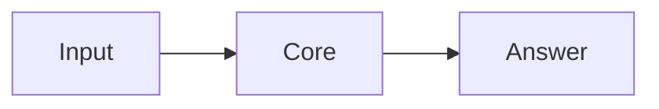

# LC 2941. Maximum GCD-Sum of a Subarray

> Hard · [LeetCode](https://leetcode.com/problems/maximum-gcd-sum-of-a-subarray/)

## 题意

长度≥k 子数组 gcd×sum 最大。

## 最优思路

GCD 段合并 + 前缀和。

## 图解

## 复杂度

| 项 | 值 |
|----|----|
| 时间 | O(n log A) |
| 空间 | O(n) |
