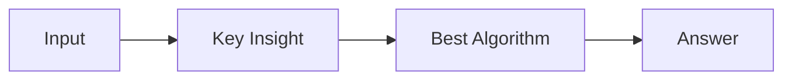

# LC 2959. Number of Possible Sets of Closing Branches

> Hard · [LeetCode](https://leetcode.com/problems/number-of-possible-sets-of-closing-branches/) · Tags: Bit Manipulation, Graph Theory, Heap (Priority Queue), Enumeration, Shortest Path

## 题意

（待补：一句话题意）

## 最优思路

（待补：最优解核心 intuition）

## 图解

## 复杂度

| 项 | 值 |
|----|----|
| 时间 | TBD |
| 空间 | TBD |

## 代码

见同目录 `2959.number-of-possible-sets-of-closing-branches.py`。

## 参考

- https://leetcode.com/problems/number-of-possible-sets-of-closing-branches/
