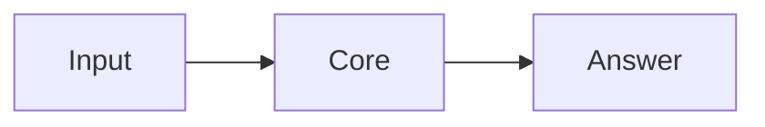

# LC 2977. Minimum Cost to Convert String II

> Hard · [LeetCode](https://leetcode.com/problems/minimum-cost-to-convert-string-ii/)

## 题意

子串替换使 source→target 最小代价。

## 最优思路

Floyd 传递闭包 + 位置 DP。

## 图解

## 复杂度

| 项 | 值 |
|----|----|
| 时间 | O(n·Σ|w|+W³) |
| 空间 | O(n+W²) |
