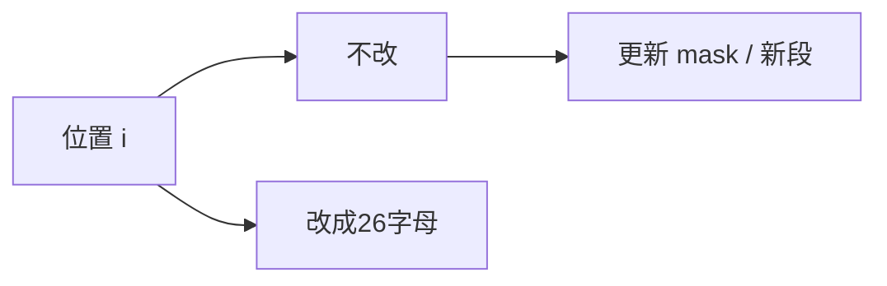

# LC 3003. Maximize the Number of Partitions After Operations

> Hard · [LeetCode](https://leetcode.com/problems/maximize-the-number-of-partitions-after-operations/) · Tags: String, Dynamic Programming, Bit Manipulation, Bitmask

## 题意

最多改一个字符，使按「段内不同字符 ≤ k」贪心分割的段数最大。

## 最优思路

记忆化搜索状态 `(i, changed, mask)`。

## 图解

## 复杂度

| 项 | 值 |
|----|----|
| 时间 | \(O(n \cdot 2^{\min(k,26)} \cdot 26)\) |
| 空间 | \(O(n \cdot 2^{\min(k,26)})\) |

## 代码

见 `3003.maximize-the-number-of-partitions-after-operations.py`。
