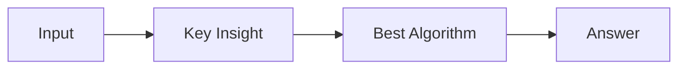

# LC 3008. Find Beautiful Indices in the Given Array II

> Hard · [LeetCode](https://leetcode.com/problems/find-beautiful-indices-in-the-given-array-ii/) · Tags: Two Pointers, String, Binary Search, Rolling Hash, String Matching, Hash Function, Z Algorithm, Knuth–Morris–Pratt Algorithm, Boyer–Moore String-Search Algorithm

## 题意

（待补：一句话题意）

## 最优思路

（待补：最优解核心 intuition）

## 图解

## 复杂度

| 项 | 值 |
|----|----|
| 时间 | TBD |
| 空间 | TBD |

## 代码

见同目录 `3008.find-beautiful-indices-in-the-given-array-ii.py`。

## 参考

- https://leetcode.com/problems/find-beautiful-indices-in-the-given-array-ii/
