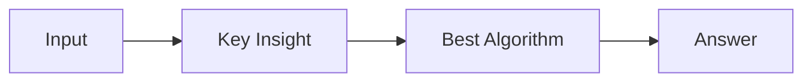

# LC 3009. Maximum Number of Intersections on the Chart

> Hard · [LeetCode](https://leetcode.com/problems/maximum-number-of-intersections-on-the-chart/) · Tags: Array, Hash Table, Math, Binary Indexed Tree, Geometry, Sweep Line, Sorting

## 题意

（待补：一句话题意）

## 最优思路

（待补：最优解核心 intuition）

## 图解

## 复杂度

| 项 | 值 |
|----|----|
| 时间 | TBD |
| 空间 | TBD |

## 代码

见同目录 `3009.maximum-number-of-intersections-on-the-chart.py`。

## 参考

- https://leetcode.com/problems/maximum-number-of-intersections-on-the-chart/
