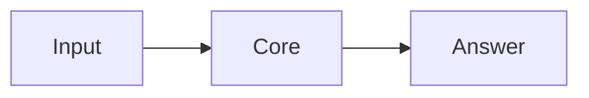

# LC 3009. Maximum Number of Intersections on the Chart

> Hard · [LeetCode](https://leetcode.com/problems/maximum-number-of-intersections-on-the-chart/)

## 题意

折线与水平线最大交点数。

## 最优思路

边覆盖区间扫线。

## 图解

## 复杂度

| 项 | 值 |
|----|----|
| 时间 | 见代码 |
| 空间 | 见代码 |
