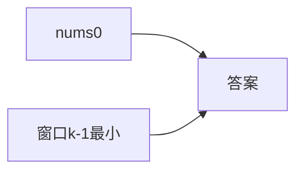

# LC 3013. Divide an Array Into Subarrays With Minimum Cost II

> Hard · [LeetCode](https://leetcode.com/problems/divide-an-array-into-subarrays-with-minimum-cost-ii/) · Tags: Array, Hash Table, Sliding Window, Heap (Priority Queue)

## 题意

分成 `k` 段，代价为段首之和；非首段起点落在长度为 `dist+1` 的窗口内。最小化。

## 最优思路

枚举右端，窗口内取 `k-1` 个最小与 `nums[0]` 相加。

## 图解

## 复杂度

| 项 | 值 |
|----|----|
| 时间 | \(O(n\,d\log d)\) |
| 空间 | \(O(d)\) |

## 代码

见 `3013.divide-an-array-into-subarrays-with-minimum-cost-ii.py`。
