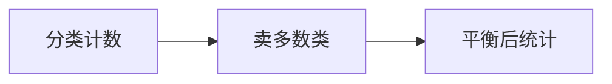

# LC 3052. Maximize Items

> Hard · [LeetCode](https://leetcode.com/problems/maximize-items/) · Tags: Database

## 题意

卖出若干商品使剩余 prime / non-prime 数量相等（或差 1 的特殊规则），最大化剩余件数（再比价格和）。

## 最优思路

分类计数，优先卖多数类中最便宜的，直到数量平衡。

## 图解

## 复杂度

| 项 | 值 |
|----|----|
| 时间 | \(O(n\log n)\) |
| 空间 | \(O(n)\) |

## 代码

见 `3052.maximize-items.py`。
