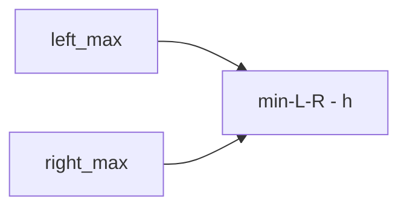

# LC 3061. Calculate Trapping Rain Water

> Hard · [LeetCode](https://leetcode.com/problems/calculate-trapping-rain-water/) · Tags: Database

## 题意

用 SQL 计算柱状图接雨水总量。

## 最优思路

窗口求左右前缀最大高度，对每位 `min(L,R)-h` 求和。

## 图解

## 复杂度

| 项 | 值 |
|----|----|
| 时间 | \(O(n)\) |
| 空间 | \(O(n)\) |

## 代码

见 `3061.calculate-trapping-rain-water.py`。
