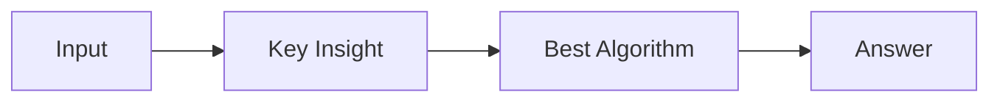

# LC 3082. Find the Sum of the Power of All Subsequences

> Hard · [LeetCode](https://leetcode.com/problems/find-the-sum-of-the-power-of-all-subsequences/) · Tags: Array, Dynamic Programming, Knapsack Problem, 0-1 Knapsack

## 题意

（待补：一句话题意）

## 最优思路

（待补：最优解核心 intuition）

## 图解

## 复杂度

| 项 | 值 |
|----|----|
| 时间 | TBD |
| 空间 | TBD |

## 代码

见同目录 `3082.find-the-sum-of-the-power-of-all-subsequences.py`。

## 参考

- https://leetcode.com/problems/find-the-sum-of-the-power-of-all-subsequences/
