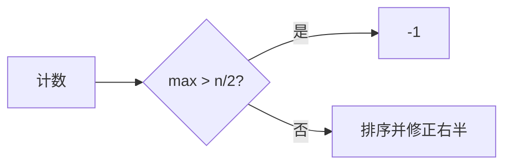

# LC 3088. Make String Anti-palindrome

> Hard · [LeetCode](https://leetcode.com/problems/make-string-anti-palindrome/) · Tags: String, Greedy, Sorting, Counting Sort

## 题意

重排字符串使对所有 `i`，`s[i]!=s[n-1-i]`；若不可能返回 `"-1"`。字典序最小。

## 最优思路

计数；若某字符 > n/2 则不可能。排序后调整右半与左半冲突。

## 图解

## 复杂度

| 项 | 值 |
|----|----|
| 时间 | \(O(n)\) |
| 空间 | \(O(n)\) |

## 代码

见 `3088.make-string-anti-palindrome.py`。
