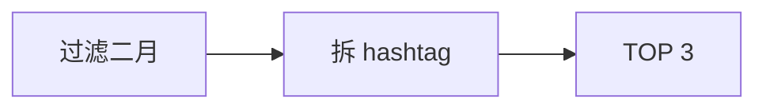

# LC 3103. Find Trending Hashtags II 

> Hard · [LeetCode](https://leetcode.com/problems/find-trending-hashtags-ii/) · Tags: Database

## 题意

统计 2024-02 推文中标签出现次数，输出前三（次数降序、字典序降序）。

## 最优思路

拆分 `#` 标签，分组计数排序截断。

## 图解

## 复杂度

| 项 | 值 |
|----|----|
| 时间 | \(O(nL)\) |
| 空间 | \(O(n)\) |

## 代码

见 `3103.find-trending-hashtags-ii.py`。
