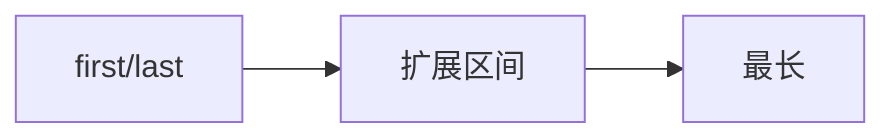

# LC 3104. Find Longest Self-Contained Substring

> Hard · [LeetCode](https://leetcode.com/problems/find-longest-self-contained-substring/) · Tags: Hash Table, String, Sorting

## 题意

最长自包含子串（所含字符全局出现均在子串内），不能是整个串。

## 最优思路

从每个字符的首次出现区间扩展到闭合。

## 图解

## 复杂度

| 项 | 值 |
|----|----|
| 时间 | \(O(26n)\) |
| 空间 | \(O(1)\) |

## 代码

见 `3104.find-longest-self-contained-substring.py`。
