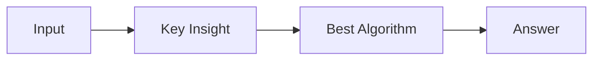

# LC 3154. Find Number of Ways to Reach the K-th Stair

> Hard · [LeetCode](https://leetcode.com/problems/find-number-of-ways-to-reach-the-k-th-stair/) · Tags: Math, Dynamic Programming, Bit Manipulation, Memoization, Combinatorics

## 题意

（待补：一句话题意）

## 最优思路

（待补：最优解核心 intuition）

## 图解

## 复杂度

| 项 | 值 |
|----|----|
| 时间 | TBD |
| 空间 | TBD |

## 代码

见同目录 `3154.find-number-of-ways-to-reach-the-k-th-stair.py`。

## 参考

- https://leetcode.com/problems/find-number-of-ways-to-reach-the-k-th-stair/
