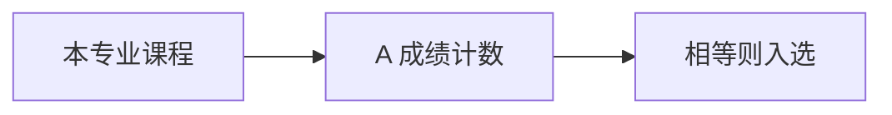

# LC 3188. Find Top Scoring Students II

> Hard · [LeetCode](https://leetcode.com/problems/find-top-scoring-students-ii/) · Tags: Database

## 题意

找出修完本专业全部课程且成绩均为 A 的学生。

## 最优思路

按专业应修门数与 A 课去重计数比对。

## 图解

## 复杂度

| 项 | 值 |
|----|----|
| 时间 | \(O(n)\) |
| 空间 | \(O(n)\) |

## 代码

见 `3188.find-top-scoring-students-ii.py`。
