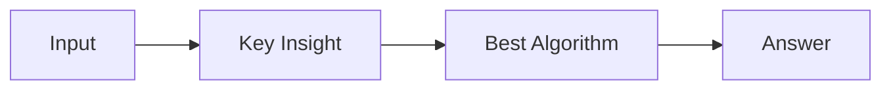

# LC 3292. Minimum Number of Valid Strings to Form Target II

> Hard · [LeetCode](https://leetcode.com/problems/minimum-number-of-valid-strings-to-form-target-ii/) · Tags: Array, String, Binary Search, Dynamic Programming, Greedy, Segment Tree, Rolling Hash, String Matching, Hash Function

## 题意

（待补：一句话题意）

## 最优思路

（待补：最优解核心 intuition）

## 图解

## 复杂度

| 项 | 值 |
|----|----|
| 时间 | TBD |
| 空间 | TBD |

## 代码

见同目录 `3292.minimum-number-of-valid-strings-to-form-target-ii.py`。

## 参考

- https://leetcode.com/problems/minimum-number-of-valid-strings-to-form-target-ii/
