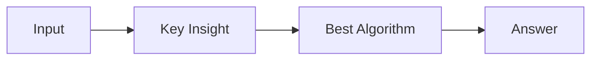

# LC 3298. Count Substrings That Can Be Rearranged to Contain a String II

> Hard · [LeetCode](https://leetcode.com/problems/count-substrings-that-can-be-rearranged-to-contain-a-string-ii/) · Tags: Hash Table, String, Sliding Window

## 题意

（待补：一句话题意）

## 最优思路

（待补：最优解核心 intuition）

## 图解

## 复杂度

| 项 | 值 |
|----|----|
| 时间 | TBD |
| 空间 | TBD |

## 代码

见同目录 `3298.count-substrings-that-can-be-rearranged-to-contain-a-string-ii.py`。

## 参考

- https://leetcode.com/problems/count-substrings-that-can-be-rearranged-to-contain-a-string-ii/
