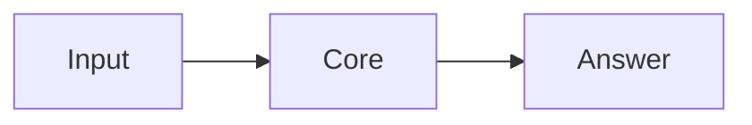

# LC 3299. Sum of Consecutive Subsequences

> Hard · [LeetCode](https://leetcode.com/problems/sum-of-consecutive-subsequences/)

## 题意

连续值子序列个数和。

## 最优思路

按值转移 end[v]。

## 图解

## 复杂度

| 项 | 值 |
|----|----|
| 时间 | 见代码 |
| 空间 | 见代码 |
