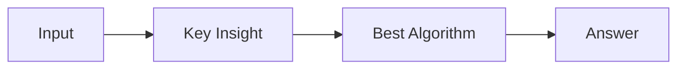

# LC 3312. Sorted GCD Pair Queries

> Hard · [LeetCode](https://leetcode.com/problems/sorted-gcd-pair-queries/) · Tags: Array, Hash Table, Math, Binary Search, Combinatorics, Counting, Number Theory, Prefix Sum, Euclidean Algorithm, Greatest Common Divisor

## 题意

（待补：一句话题意）

## 最优思路

（待补：最优解核心 intuition）

## 图解

## 复杂度

| 项 | 值 |
|----|----|
| 时间 | TBD |
| 空间 | TBD |

## 代码

见同目录 `3312.sorted-gcd-pair-queries.py`。

## 参考

- https://leetcode.com/problems/sorted-gcd-pair-queries/
