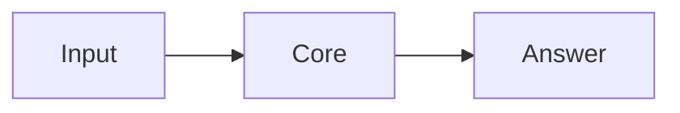

# LC 3313. Find the Last Marked Nodes in Tree

> Hard · [LeetCode](https://leetcode.com/problems/find-the-last-marked-nodes-in-tree/)

## 题意

树上标记传播最后被标记的结点。

## 最优思路

直径两端 reroot。

## 图解

## 复杂度

| 项 | 值 |
|----|----|
| 时间 | 见代码 |
| 空间 | 见代码 |
