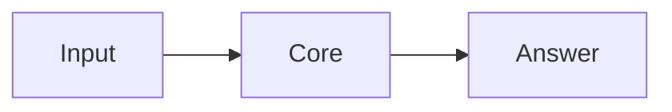

# LC 3383. Minimum Runes to Add to Cast Spell

> Hard · [LeetCode](https://leetcode.com/problems/minimum-runes-to-add-to-cast-spell/)

## 题意

加最少符文使法术能量可达。

## 最优思路

SCC 缩点后入度 0 无水晶分量。

## 图解

## 复杂度

| 项 | 值 |
|----|----|
| 时间 | 见代码 |
| 空间 | 见代码 |
