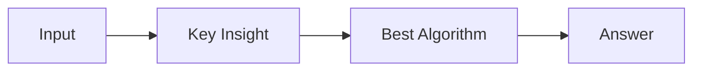

# LC 3410. Maximize Subarray Sum After Removing All Occurrences of One Element

> Hard · [LeetCode](https://leetcode.com/problems/maximize-subarray-sum-after-removing-all-occurrences-of-one-element/) · Tags: Array, Hash Table, Divide and Conquer, Dynamic Programming, Segment Tree, Prefix Sum

## 题意

（待补：一句话题意）

## 最优思路

（待补：最优解核心 intuition）

## 图解

## 复杂度

| 项 | 值 |
|----|----|
| 时间 | TBD |
| 空间 | TBD |

## 代码

见同目录 `3410.maximize-subarray-sum-after-removing-all-occurrences-of-one-element.py`。

## 参考

- https://leetcode.com/problems/maximize-subarray-sum-after-removing-all-occurrences-of-one-element/
