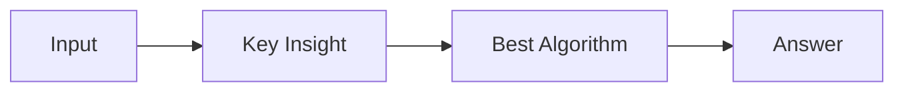

# LC 3430. Maximum and Minimum Sums of at Most Size K Subarrays

> Hard · [LeetCode](https://leetcode.com/problems/maximum-and-minimum-sums-of-at-most-size-k-subarrays/) · Tags: Array, Math, Stack, Monotonic Stack

## 题意

（待补：一句话题意）

## 最优思路

（待补：最优解核心 intuition）

## 图解

## 复杂度

| 项 | 值 |
|----|----|
| 时间 | TBD |
| 空间 | TBD |

## 代码

见同目录 `3430.maximum-and-minimum-sums-of-at-most-size-k-subarrays.py`。

## 参考

- https://leetcode.com/problems/maximum-and-minimum-sums-of-at-most-size-k-subarrays/
