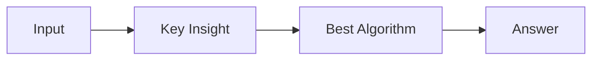

# LC 3505. Minimum Operations to Make Elements Within K Subarrays Equal

> Hard · [LeetCode](https://leetcode.com/problems/minimum-operations-to-make-elements-within-k-subarrays-equal/) · Tags: Array, Hash Table, Math, Dynamic Programming, Sliding Window, Heap (Priority Queue)

## 题意

（待补：一句话题意）

## 最优思路

（待补：最优解核心 intuition）

## 图解

## 复杂度

| 项 | 值 |
|----|----|
| 时间 | TBD |
| 空间 | TBD |

## 代码

见同目录 `3505.minimum-operations-to-make-elements-within-k-subarrays-equal.py`。

## 参考

- https://leetcode.com/problems/minimum-operations-to-make-elements-within-k-subarrays-equal/
