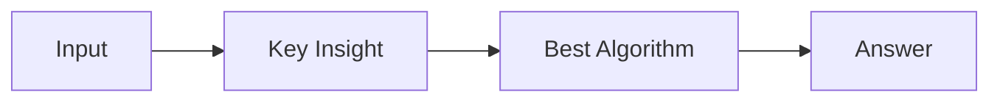

# LC 3559. Number of Ways to Assign Edge Weights II

> Hard · [LeetCode](https://leetcode.com/problems/number-of-ways-to-assign-edge-weights-ii/) · Tags: Array, Math, Dynamic Programming, Bit Manipulation, Tree, Depth-First Search

## 题意

（待补：一句话题意）

## 最优思路

（待补：最优解核心 intuition）

## 图解

## 复杂度

| 项 | 值 |
|----|----|
| 时间 | TBD |
| 空间 | TBD |

## 代码

见同目录 `3559.number-of-ways-to-assign-edge-weights-ii.py`。

## 参考

- https://leetcode.com/problems/number-of-ways-to-assign-edge-weights-ii/
