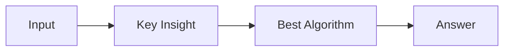

# LC 3575. Maximum Good Subtree Score

> Hard · [LeetCode](https://leetcode.com/problems/maximum-good-subtree-score/) · Tags: Array, Dynamic Programming, Bit Manipulation, Tree, Depth-First Search, Bitmask

## 题意

（待补：一句话题意）

## 最优思路

（待补：最优解核心 intuition）

## 图解

## 复杂度

| 项 | 值 |
|----|----|
| 时间 | TBD |
| 空间 | TBD |

## 代码

见同目录 `3575.maximum-good-subtree-score.py`。

## 参考

- https://leetcode.com/problems/maximum-good-subtree-score/
