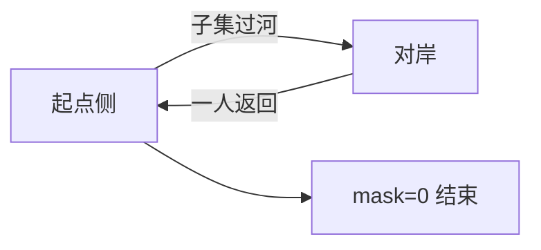

# LC 3594. Minimum Time to Transport All Individuals

> Hard · [LeetCode](https://leetcode.com/problems/minimum-time-to-transport-all-individuals/) · Tags: Array, Bit Manipulation, Graph, Heap, Shortest Path

## 题意

\(n\) 人渡河，船容量 \(k\)。过河时间 = 组内最慢者 × 当前阶段倍率 `mul[stage]`；时间推进 `floor(duration)` 改变阶段。求全部到达对岸的最短时间。

## 最优思路

状态 `(船侧, stage, 起点剩余 mask)`。倍率周期导致图中可能有环，用 Dijkstra。船在起点时枚举 `≤k` 人子掩码过河；在对岸时枚举一人返回。

## 图解

## 复杂度

| 项 | 值 |
|----|----|
| 时间 | \(O(m\cdot 3^n\log(m\cdot 3^n))\) |
| 空间 | \(O(m\cdot 2^n)\) |

## 代码

见 `3594.minimum-time-to-transport-all-individuals.py`。
