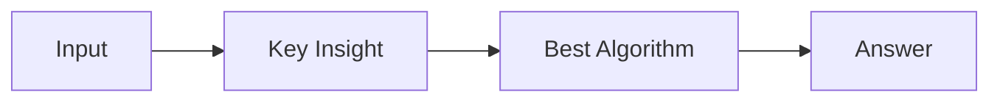

# LC 3605. Minimum Stability Factor of Array

> Hard · [LeetCode](https://leetcode.com/problems/minimum-stability-factor-of-array/) · Tags: Array, Math, Binary Search, Greedy, Segment Tree, Number Theory

## 题意

（待补：一句话题意）

## 最优思路

（待补：最优解核心 intuition）

## 图解

## 复杂度

| 项 | 值 |
|----|----|
| 时间 | TBD |
| 空间 | TBD |

## 代码

见同目录 `3605.minimum-stability-factor-of-array.py`。

## 参考

- https://leetcode.com/problems/minimum-stability-factor-of-array/
