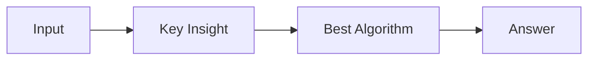

# LC 3624. Number of Integers With Popcount-Depth Equal to K II

> Hard · [LeetCode](https://leetcode.com/problems/number-of-integers-with-popcount-depth-equal-to-k-ii/) · Tags: Array, Divide and Conquer, Binary Indexed Tree, Segment Tree

## 题意

（待补：一句话题意）

## 最优思路

（待补：最优解核心 intuition）

## 图解

## 复杂度

| 项 | 值 |
|----|----|
| 时间 | TBD |
| 空间 | TBD |

## 代码

见同目录 `3624.number-of-integers-with-popcount-depth-equal-to-k-ii.py`。

## 参考

- https://leetcode.com/problems/number-of-integers-with-popcount-depth-equal-to-k-ii/
