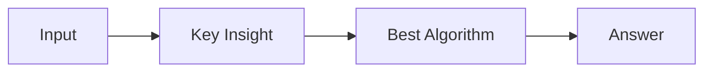

# LC 3768. Minimum Inversion Count in Subarrays of Fixed Length

> Hard · [LeetCode](https://leetcode.com/problems/minimum-inversion-count-in-subarrays-of-fixed-length/) · Tags: Array, Segment Tree, Sliding Window

## 题意

（待补：一句话题意）

## 最优思路

（待补：最优解核心 intuition）

## 图解

## 复杂度

| 项 | 值 |
|----|----|
| 时间 | TBD |
| 空间 | TBD |

## 代码

见同目录 `3768.minimum-inversion-count-in-subarrays-of-fixed-length.py`。

## 参考

- https://leetcode.com/problems/minimum-inversion-count-in-subarrays-of-fixed-length/
