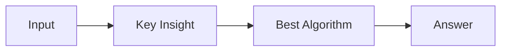

# LC 3812. Minimum Edge Toggles on a Tree

> Hard · [LeetCode](https://leetcode.com/problems/minimum-edge-toggles-on-a-tree/) · Tags: Tree, Depth-First Search, Graph Theory, Topological Sort, Sorting

## 题意

（待补：一句话题意）

## 最优思路

（待补：最优解核心 intuition）

## 图解

## 复杂度

| 项 | 值 |
|----|----|
| 时间 | TBD |
| 空间 | TBD |

## 代码

见同目录 `3812.minimum-edge-toggles-on-a-tree.py`。

## 参考

- https://leetcode.com/problems/minimum-edge-toggles-on-a-tree/
