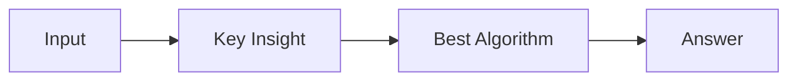

# LC 3864. Minimum Cost to Partition a Binary String

> Hard · [LeetCode](https://leetcode.com/problems/minimum-cost-to-partition-a-binary-string/) · Tags: String, Divide and Conquer, Prefix Sum

## 题意

（待补：一句话题意）

## 最优思路

（待补：最优解核心 intuition）

## 图解

## 复杂度

| 项 | 值 |
|----|----|
| 时间 | TBD |
| 空间 | TBD |

## 代码

见同目录 `3864.minimum-cost-to-partition-a-binary-string.py`。

## 参考

- https://leetcode.com/problems/minimum-cost-to-partition-a-binary-string/
