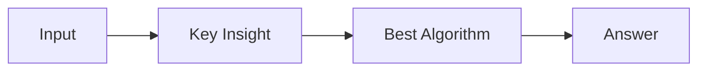

# LC 3910. Count Connected Subgraphs with Even Node Sum

> Hard · [LeetCode](https://leetcode.com/problems/count-connected-subgraphs-with-even-node-sum/) · Tags: Array, Bit Manipulation, Depth-First Search, Breadth-First Search, Union-Find, Graph Theory, Enumeration

## 题意

（待补：一句话题意）

## 最优思路

（待补：最优解核心 intuition）

## 图解

## 复杂度

| 项 | 值 |
|----|----|
| 时间 | TBD |
| 空间 | TBD |

## 代码

见同目录 `3910.count-connected-subgraphs-with-even-node-sum.py`。

## 参考

- https://leetcode.com/problems/count-connected-subgraphs-with-even-node-sum/
