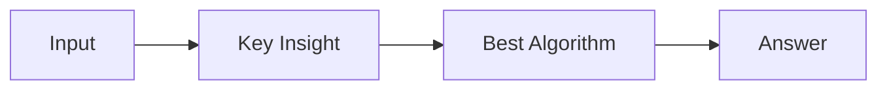

# LC 3956. Maximum Sum of M Non-Overlapping Subarrays I

> Hard · [LeetCode](https://leetcode.com/problems/maximum-sum-of-m-non-overlapping-subarrays-i/) · Tags: Array, Binary Search, Dynamic Programming, Queue, Sliding Window, Prefix Sum, Monotonic Queue

## 题意

（待补：一句话题意）

## 最优思路

（待补：最优解核心 intuition）

## 图解

## 复杂度

| 项 | 值 |
|----|----|
| 时间 | TBD |
| 空间 | TBD |

## 代码

见同目录 `3956.maximum-sum-of-m-non-overlapping-subarrays-i.py`。

## 参考

- https://leetcode.com/problems/maximum-sum-of-m-non-overlapping-subarrays-i/
