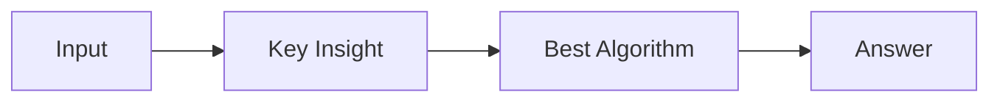

# LC 3977. Minimum Time to Reach Target With Limited Power

> Hard · [LeetCode](https://leetcode.com/problems/minimum-time-to-reach-target-with-limited-power/) · Tags: Array, Dynamic Programming, Graph Theory, Heap (Priority Queue), Shortest Path

## 题意

（待补：一句话题意）

## 最优思路

（待补：最优解核心 intuition）

## 图解

## 复杂度

| 项 | 值 |
|----|----|
| 时间 | TBD |
| 空间 | TBD |

## 代码

见同目录 `3977.minimum-time-to-reach-target-with-limited-power.py`。

## 参考

- https://leetcode.com/problems/minimum-time-to-reach-target-with-limited-power/
