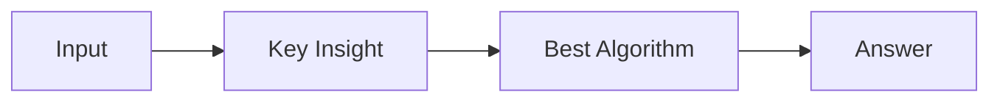

# LC 4004. Minimum Moves to Balance Circular Array II

> Hard · [LeetCode](https://leetcode.com/problems/minimum-moves-to-balance-circular-array-ii/) · Tags: Array, Math, Graph Theory, Minimum-Cost Flow

## 题意

（待补：一句话题意）

## 最优思路

（待补：最优解核心 intuition）

## 图解

## 复杂度

| 项 | 值 |
|----|----|
| 时间 | TBD |
| 空间 | TBD |

## 代码

见同目录 `4004.minimum-moves-to-balance-circular-array-ii.py`。

## 参考

- https://leetcode.com/problems/minimum-moves-to-balance-circular-array-ii/
