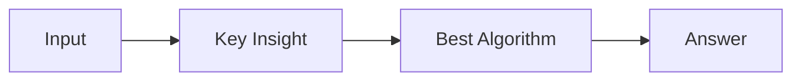

# LC 4005. Minimum Operations to Make Array Equal III

> Hard · [LeetCode](https://leetcode.com/problems/minimum-operations-to-make-array-equal-iii/) · Tags: Array, Hash Table, Math, Counting, Number Theory

## 题意

（待补：一句话题意）

## 最优思路

（待补：最优解核心 intuition）

## 图解

## 复杂度

| 项 | 值 |
|----|----|
| 时间 | TBD |
| 空间 | TBD |

## 代码

见同目录 `4005.minimum-operations-to-make-array-equal-iii.py`。

## 参考

- https://leetcode.com/problems/minimum-operations-to-make-array-equal-iii/
