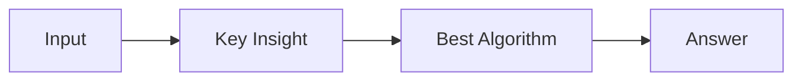

# LC 4013. Count Subarrays With Even Odd Ratio II

> Hard · [LeetCode](https://leetcode.com/problems/count-subarrays-with-even-odd-ratio-ii/) · Tags: Array, Divide and Conquer, Binary Indexed Tree, Segment Tree, Merge Sort, Prefix Sum

## 题意

（待补：一句话题意）

## 最优思路

（待补：最优解核心 intuition）

## 图解

## 复杂度

| 项 | 值 |
|----|----|
| 时间 | TBD |
| 空间 | TBD |

## 代码

见同目录 `4013.count-subarrays-with-even-odd-ratio-ii.py`。

## 参考

- https://leetcode.com/problems/count-subarrays-with-even-odd-ratio-ii/
