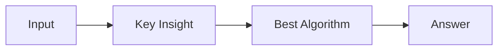

# LC 4042. Valid K-Unique Subarrays II

> Hard · [LeetCode](https://leetcode.com/problems/valid-k-unique-subarrays-ii/) · Tags: Array, Hash Table, Bit Manipulation, Binary Indexed Tree, Segment Tree, Sliding Window, Hash Function, Prefix Sum

## 题意

（待补：一句话题意）

## 最优思路

（待补：最优解核心 intuition）

## 图解

## 复杂度

| 项 | 值 |
|----|----|
| 时间 | TBD |
| 空间 | TBD |

## 代码

见同目录 `4042.valid-k-unique-subarrays-ii.py`。

## 参考

- https://leetcode.com/problems/valid-k-unique-subarrays-ii/
